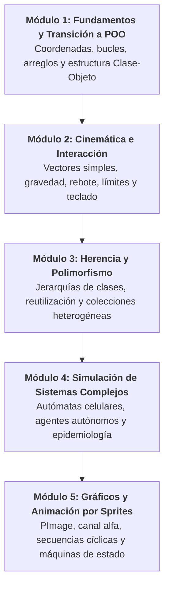

# Programación Orientada a Objetos (2026B)

Repositorio central del curso **Programación Orientada a Objetos (POO)** correspondiente al ciclo académico **2026B**.

El curso utiliza **[Processing](https://processing.org/)** (modo Java) como plataforma de aprendizaje visual, aplicando los principios del paradigma orientado a objetos al modelado de simulaciones físicas 2D, cinemática, autómatas celulares, animación por sprites y videojuegos interactivos.

---

## 📋 Tabla de Contenidos

- [Programación Orientada a Objetos (2026B)](#programación-orientada-a-objetos-2026b)
  - [📋 Tabla de Contenidos](#-tabla-de-contenidos)
  - [⚙️ Entorno y Requisitos](#️-entorno-y-requisitos)
  - [🧭 Mapa Curricular por Módulos](#-mapa-curricular-por-módulos)
  - [📅 Bitácora Cronológica de Clases](#-bitácora-cronológica-de-clases)
  - [📂 Catálogo de Ejercicios y Retos](#-catálogo-de-ejercicios-y-retos)
  - [📐 Convenciones y Buenas Prácticas de POO](#-convenciones-y-buenas-prácticas-de-poo)

---

## ⚙️ Entorno y Requisitos

1. **Software:** [Processing 4.x](https://processing.org/download/) con entorno estándar de Java.
2. **Estructura de proyectos:** Cada sketch reside en una carpeta homónima a su archivo `.pde` principal:
   ```text
   nombre_sketch/
   ├── nombre_sketch.pde   # Función setup(), draw(), bucle principal
   ├── MiClase.pde         # Definición de clases adicionales
   └── data/               # Imágenes (.png, .jpg), fuentes o sonidos
   ```
3. **Ejecución:** Abrir el archivo `.pde` principal en Processing y presionar **Run** (`Ctrl+R` / `Cmd+R`).

---

## 🧭 Mapa Curricular por Módulos



### Módulo 1: Fundamentos y Transición a POO
- Coordenadas de pantalla (origen superior izquierdo, $Y$ descendente).
- Abstracción de datos: paso de variables y funciones sueltas a estructuras encapsuladas en clases.
- Constructores simples y sobrecargados.
- Métodos clave del ciclo de vida: separación entre actualización de estado (`actualizar()`) y renderizado (`dibujar()`).

### Módulo 2: Cinemática e Interacción
- Movimiento continuo, velocidad y aceleración constante (gravedad).
- Rebote elástico y control de bordes de pantalla.
- Detección de colisiones circulares y rectangulares (cajas de colisión / *bounding box*).
- Manejo de periféricos: interacción fluida con teclado continuo y ratón.

### Módulo 3: Herencia, Polimorfismo y Control Temporal
- Superclases y subclases utilizando la palabra clave `extends`.
- Polimorfismo: tratamiento homogéneo de arreglos de objetos derivados (`enemigo.pde` base con variantes rápida y errática).
- Temporizadores e intervalos mediante `millis()` (`Reloj.pde`).

### Módulo 4: Simulación de Sistemas Complejos
- Modelado de agentes con estados internos (ej. simulación epidemiológica: células sanas, infectadas y anticuerpos).
- Reglas de transición de estados por cercanía y contagio.

### Módulo 5: Recursos Gráficos y Animación
- Gestión de memoria y recursos visuales (`PImage`).
- Canales alfa y transparencia en formatos PNG.
- Sistemas modulares de animación: encapsulación de fotogramas (`Imagen.pde`), tiras de fotogramas (`Secuencia.pde`) y controladores de personaje (`Personaje.pde`).
- Máquinas de estado finitas (`enum`) para coordinar animaciones (reposo, caminar, correr).

---

## 📅 Bitácora Cronológica de Clases

| Fecha | Directorio | Contenido y Sketches | Conceptos Abordados |
| :--- | :--- | :--- | :--- |
| **2026-08-14** | [2026-08-14/](file:///Users/haile/src/programacion-orientada-objetos-2026B/2026-08-14) | • `sketch_holamundo`<br>• `sketch_cuadrado` | Primeros pasos con Processing, lienzo, canvas y primitivas gráficas. |
| **2026-08-18** | [2026-08-18/](file:///Users/haile/src/programacion-orientada-objetos-2026B/2026-08-18) | • `sketch_cuadrado_color`<br>• `sketch_cuadrado_color_arreglo`<br>• `sketch_cuadrado_funciones` | Modularización con funciones, arreglos unidimensionales y gestión de color. |
| **2026-08-21** | [2026-08-21/](file:///Users/haile/src/programacion-orientada-objetos-2026B/2026-08-21) | • `sketch_clase`<br>• `sketch_tablero` | Transición a estructuras orientadas a objetos y generación de tableros matriciales. |
| **2026-08-28** | [2026-08-28/](file:///Users/haile/src/programacion-orientada-objetos-2026B/2026-08-28) | • `sketch_clase_cuadrado`<br>• `sketch_clase_cuadrado_aleatorio` | Creación formal de clases en pestañas separadas (`cuadrado.pde`), instanciación y constructores. |
| **2026-09-04** | [2026-09-04/](file:///Users/haile/src/programacion-orientada-objetos-2026B/2026-09-04) | • `sketch_260904a_caida`<br>• `sketch_260904a_caida_constructor`<br>• `sketch_260904a_rebote`<br>• `sketch_260904a_rebote_aleatorio` | Clase `Circulo.pde`, cinemática 1D (gravedad vertical), rebote contra el suelo y constructores parametrizados. |
| **2026-09-08** | [2026-09-08/](file:///Users/haile/src/programacion-orientada-objetos-2026B/2026-09-08) | • `sketch_260908a_disco`<br>• `sketch_260908a_rebote`<br>• `sketch_260908b_jetpack`<br>• `sketch_260908b_jetpack_limite` | Física bidimensional (`Disco.pde`), límites perimetrales y control dinámico con propulsión (`Jetpack.pde`). |
| **2026-09-11** | [2026-09-11/](file:///Users/haile/src/programacion-orientada-objetos-2026B/2026-09-11) | • `sketch_260911a_zombie`<br>• `sketch_260911b_interaccion`<br>• `sketch_260911b_interaccion_completa`<br>• `sketch_260911b_lluvia` | Interacción multi-objeto, persecución hacia objetivo (`Zombie.pde`), colisiones y emisión continua (`lluvia`). |
| **2026-09-18** | [2026-09-18/](file:///Users/haile/src/programacion-orientada-objetos-2026B/2026-09-18) | • `sketch_260918b_herencia` | **Herencia en POO**: Definición de clase base `Objeto.pde` y especialización con subclases `Nave.pde` y `Cometa.pde`. |
| **2026-09-22** | [2026-09-22/](file:///Users/haile/src/programacion-orientada-objetos-2026B/2026-09-22) | • `sketch_260922a_enemigo`<br>• `sketch_260922a_enemigo_arreglo` | **Polimorfismo**: Superclase `enemigo.pde` y subclases `EnemigoNervioso.pde` y `EnemigoRapido.pde`. Manejo con arreglos polimórficos. |
| **2026-09-25** | [2026-09-25/](file:///Users/haile/src/programacion-orientada-objetos-2026B/2026-09-25) | • `sketch_260922a_ejercicio` | Integración de sistemas: herencia (`Objeto`), temporizadores con `Reloj.pde`, y control de oleadas de enemigos. |
| **2026-10-09** | [2026-10-09/](file:///Users/haile/src/programacion-orientada-objetos-2026B/2026-10-09) | • `sketch_261009a_laInfeccion`<br>• `sketch_261009a_laCompleto` | Simulación de autómata celular: `Celula.pde`, `CelulaSana.pde`, `CelulaInfectada.pde` y `CelulaAnticuerpo.pde`. |
| **2026-10-13** | [2026-10-13/](file:///Users/haile/src/programacion-orientada-objetos-2026B/2026-10-13) | • `sketch_261013a_imagen`<br>• `sketch_261013a_leerImagen`<br>• `sketch_261013a_imagen_alpha` | Carga de recursos externos con `loadImage()`, renderizado con `image()` y manipulación del canal alfa/tintado. |
| **2026-10-16** | [2026-10-16/](file:///Users/haile/src/programacion-orientada-objetos-2026B/2026-10-16) | • `sketch_261016b_problema1` a `4`<br>• `sketch_261016b_animacion` | Taller de resolución de problemas algorítmicos y fundamentos de ciclo de frames para animación. |
| **2026-10-20** | [2026-10-20/](file:///Users/haile/src/programacion-orientada-objetos-2026B/2026-10-20) | • `sketch_261016b_animacion`<br>• `sketch_261016b_secuencia_animacion`<br>• `sketch_261016b_animacion_movimiento` | Arquitectura de animación: clases `Imagen.pde`, `Secuencia.pde` e integración con movimiento de `Personaje.pde`. |
| **2026-10-23** | [2026-10-23/](file:///Users/haile/src/programacion-orientada-objetos-2026B/2026-10-23) | • `sketch_261016b_personaje` | Controlador de personaje completo: máquina de estados (`enum TipoAnimacion`), transiciones idle/walk/run y scroll/escenario. |

---

## 📂 Catálogo de Ejercicios y Retos

Las guías detalladas para actividades prácticas y evaluaciones se encuentran en la carpeta [`ejercicios/`](file:///Users/haile/src/programacion-orientada-objetos-2026B/ejercicios):

| Guía | Título | Temas Clave |
| :---: | :--- | :--- |
| [01](file:///Users/haile/src/programacion-orientada-objetos-2026B/ejercicios/01_caida_libre.md) | **El círculo en caída libre** | Estructura básica de una clase, coordenadas de Processing, gravedad y aceleración en $Y$. |
| [02](file:///Users/haile/src/programacion-orientada-objetos-2026B/ejercicios/02_rebote.md) | **El círculo rebotador** | Inversión de velocidad en límites de pantalla y disipación de energía. |
| [03](file:///Users/haile/src/programacion-orientada-objetos-2026B/ejercicios/03_movimiento_continuo.md) | **Movimiento continuo** | Cinemática en 2 dimensiones ($X$ y $Y$), vectores de velocidad constantes. |
| [04](file:///Users/haile/src/programacion-orientada-objetos-2026B/ejercicios/04_disco_hockey.md) | **El disco de hockey** | Rebote perimetral continuo en 4 bordes y fricción superficial. |
| [05](file:///Users/haile/src/programacion-orientada-objetos-2026B/ejercicios/05_nave_espacial.md) | **Nave espacial controlada** | Entrada interactiva por teclado continuo, aceleración y límites envolventes (*wrap-around*). |
| [06](file:///Users/haile/src/programacion-orientada-objetos-2026B/ejercicios/06_zombi_perseguidor.md) | **Zombi perseguidor** | Comportamientos de atracción (perseguir el cursor del ratón u otro objeto). |
| [07](file:///Users/haile/src/programacion-orientada-objetos-2026B/ejercicios/07_brasa_magica.md) | **Brasa mágica** | Modificación de propiedades en tiempo real (tamaño, color, desvanecimiento). |
| [08](file:///Users/haile/src/programacion-orientada-objetos-2026B/ejercicios/08_mosca_asustadiza.md) | **Mosca asustadiza** | Comportamientos de repulsión y evasión frente a proximidad del cursor. |
| [09](file:///Users/haile/src/programacion-orientada-objetos-2026B/ejercicios/09_invasion_enemigos.md) | **Invasión de enemigos** | Manejo de arreglos dinámicos de objetos e instancias en masa. |
| [09b](file:///Users/haile/src/programacion-orientada-objetos-2026B/ejercicios/09b_nave_defensora.md) | **Nave defensora** | Sistemas de proyectiles, colisiones de partículas con enemigos y eliminación de elementos. |
| [10](file:///Users/haile/src/programacion-orientada-objetos-2026B/ejercicios/10_sistema_particulas.md) | **Sistema de partículas** | Emisores (*emitters*), ciclo de vida, decaimiento (*lifespan*) y reciclaje de objetos. |
| [11](file:///Users/haile/src/programacion-orientada-objetos-2026B/ejercicios/11_power_ups.md) | **Power-Ups** | Modificadores temporales de estado aplicados sobre entidades principales. |
| [12](file:///Users/haile/src/programacion-orientada-objetos-2026B/ejercicios/12_la_infeccion.md) | **Caso: La Infección** | Simulación epidemiológica multi-agente con estados contagiosos. |
| [12](file:///Users/haile/src/programacion-orientada-objetos-2026B/ejercicios/12_el_acuario_depredador.md) | **Caso: El Acuario Depredador** | Cadena trófica simulada: presas, depredadores y ciclo de energía. |
| [12](file:///Users/haile/src/programacion-orientada-objetos-2026B/ejercicios/12_defensa_antiaerea.md) | **Caso: Defensa Antiaérea** | Trayectorias balísticas, retículas de apuntado y áreas de daño (*AoE*). |
| [12](file:///Users/haile/src/programacion-orientada-objetos-2026B/ejercicios/12_cruce_peligroso.md) | **Caso: Cruce Peligroso** | Simulación tipo Frogger: flujo vehicular a distintas velocidades y detección de impacto. |
| [12](file:///Users/haile/src/programacion-orientada-objetos-2026B/ejercicios/12_la_cosecha.md) | **Caso: La Cosecha** | Recolección de recursos, cronómetros y puntuación acumulada. |
| [12](file:///Users/haile/src/programacion-orientada-objetos-2026B/ejercicios/12_repaso_equipos.md) | **Repaso en Equipos** | Guía integradora de conceptos para proyectos colaborativos. |

---

## 📐 Convenciones y Buenas Prácticas de POO

1. **Nomenclatura:**
   - **Clases:** `UpperCamelCase` (e.g. `EnemigoRapido`, `SecuenciaAnimacion`, `CelulaSana`).
   - **Métodos y Atributos:** `lowerCamelCase` (e.g. `actualizar()`, `velocidadMax`, `radioColision`).
   - **Constantes y Enums:** `UPPER_SNAKE_CASE` (e.g. `TipoAnimacion.ESPERA`).

2. **Separación de responsabilidades:**
   - Mantener las funciones de lógica (`actualizar()`, `mover()`, `verificarColision()`) separadas de las funciones visuales (`dibujar()`, `mostrar()`).
   - Evitar llamadas directas a variables globales dentro de las clases; pasar dependencias a través del constructor o argumentos de métodos.

3. **Modularidad en Processing:**
   - Cada clase representativa debe colocarse en su propia pestaña (`.pde`) dentro del sketch para favorecer la legibilidad y el mantenimiento.
